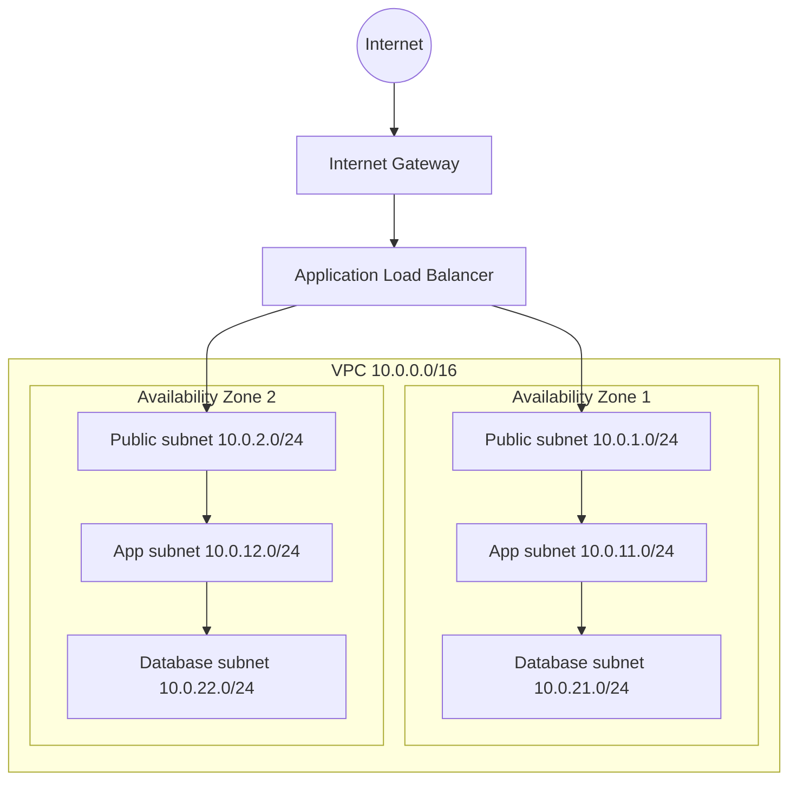
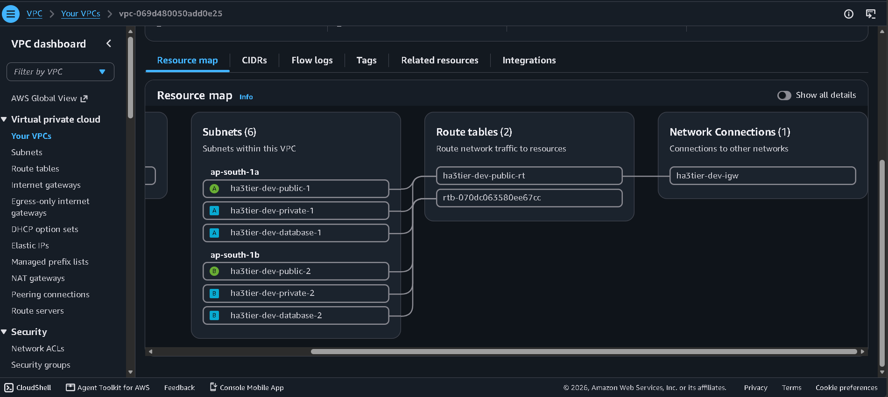
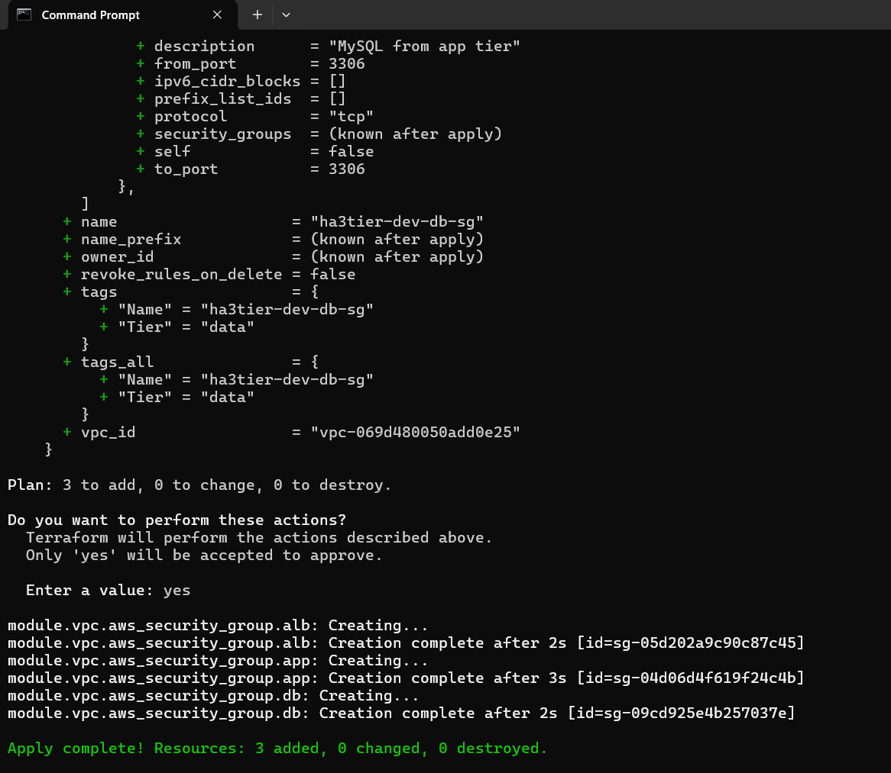
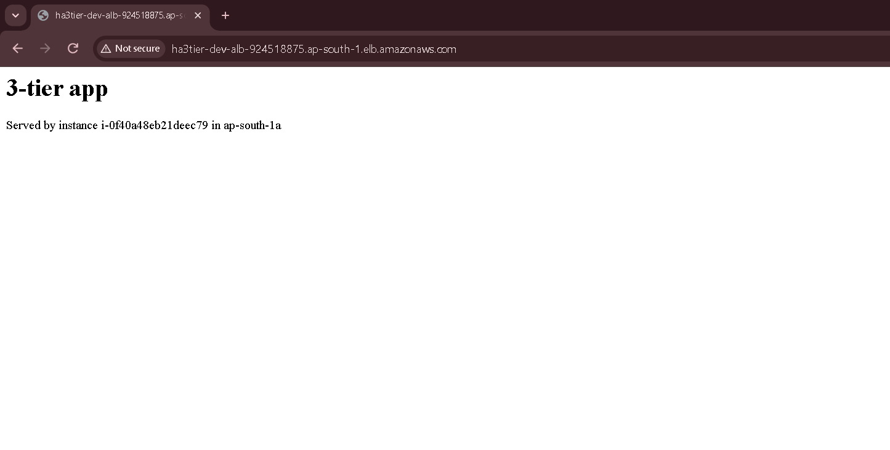
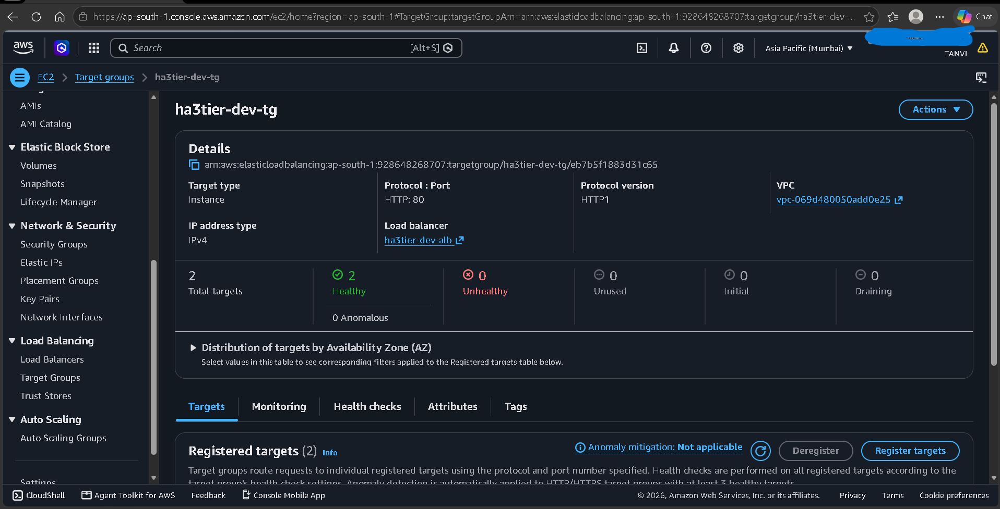

# AWS Highly Available 3-Tier Architecture with Terraform

A highly available three-tier architecture on AWS, defined entirely as code with reusable Terraform modules. It covers networking, security, load balancing, auto scaling, a Multi-AZ database, monitoring and a basic CI pipeline. I built it layer by layer, tested each layer, and destroyed and recreated the whole stack to keep costs close to zero.

Status: complete (version 1). Known limitations and planned improvements are listed at the end.

## What this project demonstrates

- Infrastructure defined as code, with nothing created by hand in the console
- Redundancy across two Availability Zones at every tier
- Network isolation: the database has no route to the internet
- Least-privilege security groups, where each tier only trusts the tier above it
- Reusable modules that could serve more than one environment
- Cost control: expensive resources sit behind a switch and everything can be destroyed with one command

## Architecture



| Tier | Subnets | What runs there | Internet access |
|---|---|---|---|
| Web | Public, two AZs | Application Load Balancer | Directly, through the internet gateway |
| Application | Private, two AZs | EC2 instances in an Auto Scaling Group running nginx | Outbound only, through a NAT gateway |
| Data | Private, two AZs | Multi-AZ RDS MySQL | None |

## Security design

Each tier has its own security group, and each one only accepts traffic from the tier above it.

| Security group | Accepts traffic from | Port |
|---|---|---|
| Load balancer | The internet | 80 |
| Application | The load balancer security group only | 80 |
| Database | The application security group only | 3306 |

Other security decisions:
- The database master password is generated and stored by AWS Secrets Manager, so no password appears in the code or the repository.
- The database is not publicly accessible and its subnets have no internet route.
- Terraform runs as a dedicated IAM user, not the root account, with permissions added one stage at a time.
- The alert email address is kept in a git-ignored variables file, not in the repository.

## Components

| Module | What it creates |
|---|---|
| `modules/vpc` | VPC, six subnets, internet gateway, route tables, optional NAT gateway, three security groups |
| `modules/compute` | Application Load Balancer, target group, launch template, Auto Scaling Group (2 to 4 instances) |
| `modules/database` | Multi-AZ RDS MySQL instance, DB subnet group, password managed by Secrets Manager |
| `modules/monitoring` | CloudWatch dashboard, alarms for unhealthy servers and high CPU, SNS email notifications |

A GitHub Actions workflow runs `terraform fmt -check` and `terraform validate` on every push.

## What I tested

- **Load balancing across zones.** I sent repeated requests to the load balancer address. Each server returns its own instance ID and Availability Zone, and responses came from both zones.
- **Database failover.** I forced a failover on the Multi-AZ database and confirmed that the primary moved to the other Availability Zone.
- **Rebuild from scratch.** I destroyed the whole stack and recreated it with `terraform apply`.
- **Alerting.** I forced an alarm into the alarm state to confirm the email notification arrives. This tested the notification path, not a real failure.

## Screenshots

Network layout: VPC, subnets, route tables and internet gateway



Security groups, with the database group accepting traffic only from the application group



Application served through the load balancer from a private subnet


Requests served by both Availability Zones



Both targets healthy behind the load balancer



CI workflow passing format and validate checks


## Repository layout

```
environments/
  dev/            provider configuration, module calls and outputs
modules/
  vpc/            network, routing and security groups
  compute/        load balancer, launch template, Auto Scaling Group
  database/       Multi-AZ RDS
  monitoring/     CloudWatch dashboard, alarms, SNS
docs/
  screenshots/    evidence from the deployed environment
.github/
  workflows/      CI workflow
```

## How to run it

Requirements: Terraform 1.5 or later, and the AWS CLI configured with an IAM user that can manage VPC, EC2, load balancing, auto scaling, RDS, Secrets Manager, CloudWatch and SNS.

Create `environments/dev/terraform.tfvars` with your own email address for alarm notifications. This file is git-ignored.

```
alert_email = "you@example.com"
```

Then run everything from `environments/dev`:

```
cd environments/dev
terraform init
terraform plan
terraform apply
```

The load balancer address is printed as `alb_url` when the apply finishes. The database takes 10 to 15 minutes to create. AWS sends a subscription confirmation email, which must be confirmed before alarm notifications arrive.

## Cost control

Several resources bill by the hour, namely the NAT gateway, the load balancer, the instances and the Multi-AZ database. I created the stack for testing and destroyed it afterwards.

```
terraform destroy
```

The NAT gateway also sits behind a variable (`enable_nat_gateway`) so it can be switched off while keeping the rest of the network.

## Limitations

- The nginx servers do not connect to the database yet. The failover test shows the data tier recovering on its own, not an application surviving it.
- One NAT gateway is shared by both zones. A production setup would use one per zone, because a single NAT gateway is a single point of failure.
- The load balancer listens on HTTP only. There is no HTTPS or custom domain.
- Terraform state is stored locally. A team setup would use remote state in S3 with locking.

## Future improvements

- Add `terraform plan` to the CI pipeline using a short-lived AWS role instead of stored keys
- Move Terraform state to S3 with locking
- Add HTTPS with an ACM certificate
- Use one NAT gateway per Availability Zone
- Connect a real application to the database

## What I learned

- Terraform only reads the files in the folder it is run from, so project layout matters.
- A subnet is only public when it has a route to an internet gateway. The name alone does nothing.
- Security groups can reference other security groups, which keeps tier-to-tier rules cleaner than IP ranges.
- State files can hold sensitive data and must never be committed.
- Small, frequent commits and a destroy at the end of each session keep both the history and the bill clean.

## Author

Tanvi
GitHub: https://github.com/Tanvi-s26